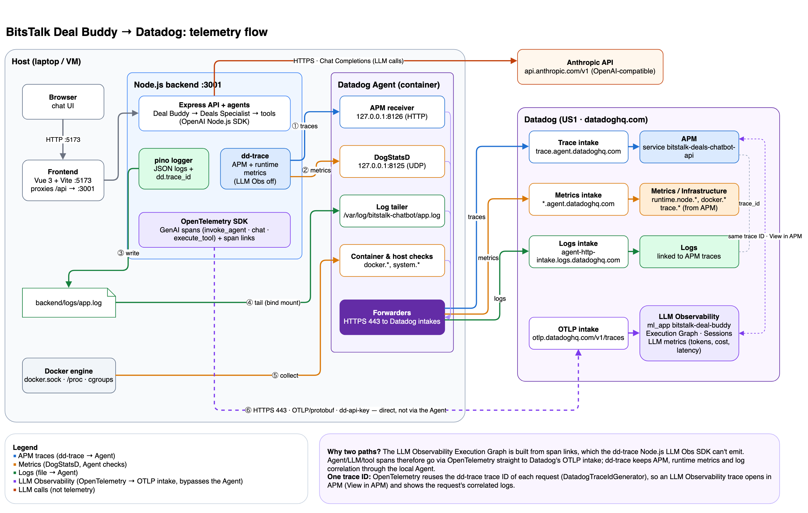

# BitsTalk Deal Buddy – RAG chatbot

| Branch | Contents |
|---|---|
| `main` | Agent instrumented with Datadog: APM, logs and LLM Observability with a working Execution Graph |
| `no-instrumentation` | The same agent without any Datadog code |

Step-by-step guide: [`docs/datadog-instrumentation-guide.html`](docs/datadog-instrumentation-guide.html) (download and open in a browser). `git diff no-instrumentation main` shows every change it describes.



Telemetry flow diagram: [`docs/datadog-communication-flow.drawio`](docs/datadog-communication-flow.drawio) (open in [diagrams.net](https://app.diagrams.net)). APM traces, runtime metrics (DogStatsD), container metrics and logs go through the local Datadog Agent; LLM Observability goes straight to Datadog's OTLP intake.

## Layout
- `backend/` – Node.js + Express API, multi-agent design using the OpenAI Node.js SDK (Chat Completions + tool calling) against Anthropic's OpenAI-compatible endpoint (`https://api.anthropic.com/v1/`), so Claude remains the model provider. Logs are JSON (pino) and go to stdout and `backend/logs/app.log`.
- `frontend/` – Vue 3 (Composition API, `<script setup>`) + Vite. `/api` is proxied to `localhost:3001`.

## Run
```bash
export ANTHROPIC_API_KEY=sk-ant-...
./start.sh           # backend :3001 + frontend http://localhost:5173
./stop.sh            # stop backend, frontend and the Datadog Agent
./stop.sh --keep-agent   # stop only the app (Ctrl+C in the start.sh terminal does the same)
```
Optional overrides: `ANTHROPIC_MODEL`, `SPECIALIST_MODEL`.

## Agent design
```
POST /api/chat
 └─ agent: deal-buddy (orchestrator, ANTHROPIC_MODEL)
     ├─ tool: check_network_coverage        (mock coverage API)
     └─ tool: consult_deals_specialist
         └─ agent: deals-specialist (sub-agent, SPECIALIST_MODEL)
             ├─ retrieval: search_deals      (BM25 over data/bitstalk_deals.txt)
             └─ tool: calculate_contract_cost
```
- `src/agents/runAgent.js` – generic tool-use loop shared by both agents
- `src/agents/orchestrator.js`, `src/agents/dealsSpecialist.js` – prompts + tool sets
- `src/tools/` – tool implementations

The chat response includes `steps` (every tool call per agent), which the UI shows under "Agent activity".

## API
- `GET  /api/health`
- `GET  /api/deals` – list of deal IDs/titles
- `POST /api/chat` – `{ sessionId, messages: [{role, content}] }` → `{ reply, sources, steps, usage }`

## Datadog instrumentation
`./start.sh` reads `DD_API_KEY` with `getSecretKey BITSTALK_DD_API_KEY`, starts a dedicated Agent container (`datadog/agent.sh`, key in the 0600 file `.dd/datadog.env`) and runs the backend with `node --import dd-trace/initialize.mjs`.

| Signal | How |
|---|---|
| APM | service `bitstalk-deals-chatbot-api`, env `pov`. Express, HTTP and the OpenAI SDK are auto-instrumented. |
| LLM Observability | **OpenTelemetry GenAI** spans -> Datadog OTLP intake (`https://otlp.datadoghq.com/v1/traces`, headers `dd-api-key`, `dd-otlp-source=llmobs`, `DD-LLMObs-Enabled=true`). `service.name` (`bitstalk-deal-buddy`) becomes the ml_app; `gen_ai.conversation.id` (the chat `sessionId`) groups turns into LLM Obs Sessions. dd-trace's own LLM Obs is off to avoid duplicate LLM spans. OTel traces reuse the dd-trace trace ID of the request (`DatadogTraceIdGenerator` in `src/otel.js`), so an LLM Obs trace opens in APM (**View in APM**) with its correlated logs. |
| Logs | pino JSON -> `backend/logs/app.log`, tailed by the Agent (`datadog/conf.d/bitstalk-chatbot.d`). `DD_LOGS_INJECTION=true` adds `dd.trace_id`/`dd.span_id` (APM); agent logs also carry `otel_trace_id` (LLM Obs trace). |
| Runtime metrics | `DD_RUNTIME_METRICS_ENABLED=true` via DogStatsD :8125 |

### Why OpenTelemetry for LLM Obs
The **Execution Graph** draws its edges from span links between spans of the same trace
(`{from: "output", to: "input"}`). The dd-trace Node.js LLM Obs SDK (6.25) can't emit span links; OTel can.

- `src/otel.js` registers a `NodeTracerProvider` with the OTLP exporter.
- `src/agents/runAgent.js` creates `invoke_agent`, `chat` and `execute_tool` spans (the OpenAI SDK has no native OTel spans, so `chat` spans are created around each Chat Completions call) and the data-flow links:

```
invoke_agent deal-buddy ─input→ chat(sonnet) ─output→ execute_tool check_network_coverage ─output→ chat(sonnet) ─output→ agent output
                                             └output→ execute_tool consult_deals_specialist ─output→ ┘
                                                        └input→ invoke_agent deals-specialist ─input→ chat(haiku) ─→ execute_tool search_deals ─→ chat(haiku) ─→ execute_tool calculate_contract_cost ─→ chat(haiku) ─output→ agent output ─output→ consult_deals_specialist
```
Stop everything with `./stop.sh`, or only the Agent with `datadog/agent.sh down`.

## Log format
Each line is JSON with `level` (string), `time` (ISO), `service`, `env`, `version`, `req.id`, `session_id`, plus `agent`, `event` (`agent.start`, `agent.llm_call`, `tool.call`, `rag.retrieve`, `agent.end`, `chat.completed`, `llm.error`) and timing/token fields.
